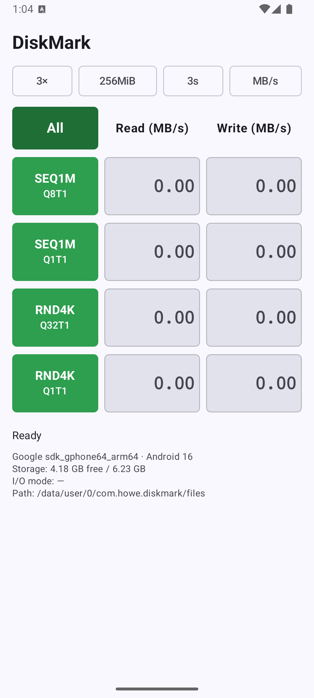
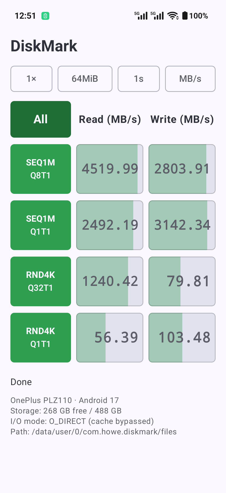

<p align="center"></p>

<h1 align="center">DiskMark</h1>

<p align="center">Android 存储测速工具，测试项目与 CrystalDiskMark 一致<br>A CrystalDiskMark-style storage benchmark for Android</p>

<p align="center">
  <a href="https://github.com/aahowe/DiskMark/releases/latest"></a>
  
  
</p>

<p align="center">
  
  &nbsp;&nbsp;
  
</p>

## 功能

| 测试 | 说明 |
|---|---|
| SEQ1M Q8T1 | 1 MiB 顺序读写，8 并发 |
| SEQ1M Q1T1 | 1 MiB 顺序读写，单并发 |
| RND4K Q32T1 | 4 KiB 随机读写，32 并发 |
| RND4K Q1T1 | 4 KiB 随机读写，单并发 |

- **绕过页缓存**：测试引擎是 C 写的（[`diskbench.c`](app/src/main/cpp/diskbench.c)），用 `O_DIRECT` 和 4K 对齐缓冲区直接测闪存。若文件系统不支持 O_DIRECT，会退回带缓冲的 I/O，并在界面上标出
- **队列深度**：用 QD×T 个线程同步 `pread`/`pwrite` 模拟（Android 应用没有通用的异步 I/O 接口），所以高 QD 下的结果比 Windows 上的 CrystalDiskMark 偏保守
- **可调参数**：测试次数（取最大值）、文件大小（64MiB–4GiB）、每次时长，显示单位可切换 MB/s、GB/s、IOPS、μs
- 测试文件写在应用私有目录，测完自动删除，不需要任何权限

## 下载

到 [Releases](https://github.com/aahowe/DiskMark/releases/latest) 下载 `DiskMark-1.0.0.apk`，支持 Android 8.0 及以上（arm64 / armv7 / x86_64 / x86）。

## 实测：OnePlus PLZ110（骁龙 SM8850，Android 17）

设置为 1GiB、3 次、每次 3s，O_DIRECT 生效：

| 测试 | 读 MB/s | 读 IOPS | 写 MB/s | 写 IOPS |
|---|---:|---:|---:|---:|
| SEQ1M Q8T1 | 4240.65 | 4044 | 2626.09 | 2504 |
| SEQ1M Q1T1 | 2192.48 | 2091 | 3033.65 | 2893 |
| RND4K Q32T1 | 1122.38 | 274019 | 79.23 | 19342 |
| RND4K Q1T1 | 46.21 | 11282 | 90.95 | 22204 |

> 在模拟器上测出的数值会偏高，因为模拟器的虚拟磁盘落在宿主机的页缓存上。要拿到可信的数据，请用真机测试。

## 构建

需要 JDK 17+，以及 Android SDK 36、NDK 29、CMake 3.31。用 Android CLI 安装：

```bash
android sdk install platforms/android-36 ndk/29.0.14206865 cmake/3.31.6
./gradlew assembleDebug
```

Release 签名会读取根目录的 `keystore.properties`（字段为 `storeFile`、`storePassword`、`keyAlias`、`keyPassword`）。这个文件没有时，Release 包不签名。

## 测试

```bash
./scripts/e2e.sh                         # 单元测试 → 构建 → android run 安装 → UI 测试
BENCH=1 DEVICE=<serial> ./scripts/e2e.sh # 再跑一次完整测速，从 logcat 打印结果
```

UI 测试（[`scripts/uitest.py`](scripts/uitest.py)）全部用 Android CLI 驱动：

- `android layout` 读界面结构，`adb shell input` 点击，`android screen capture` 截图；除了 Android CLI 自带的 instrumentation，不需要往设备上装别的东西
- 按 Compose `testTag` 定位元素，它通过 `testTagsAsResourceId` 暴露为 resource-id。DropdownMenu 弹出的是独立窗口，要在它上面再设置一次
- 测试运行时进度条一直在动，`android layout` 默认会等界面静止，所以轮询状态时要加 `--no-idle`
- JUnit 报告和截图输出到 `build/uitest/`；测试失败时会自动保存一张截图

## License

[MIT](LICENSE)
